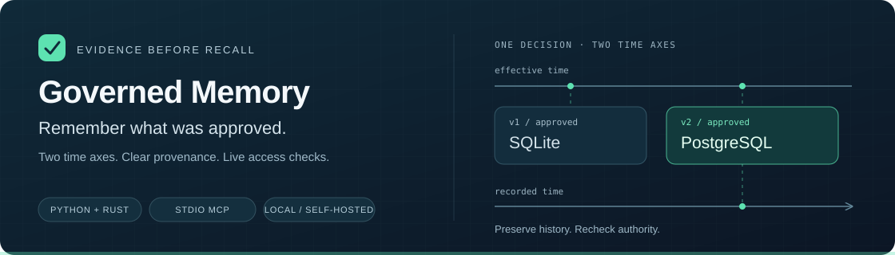
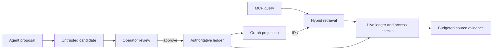

<p align="center"></p>

# Governed Memory

[](https://github.com/LE0-Lin/governed-memory/actions/workflows/ci.yml)
[](https://github.com/LE0-Lin/governed-memory/releases/latest)
[](pyproject.toml)
[](LICENSE)

**Persistent evidence memory for coding agents, with operator approval and two time axes.**

[中文](README.zh-CN.md) · [Get started](docs/getting-started.md) · [Connect MCP](docs/getting-started.md#connect-an-mcp-client) · [Measurements](docs/evaluation.md) · [Releases](https://github.com/LE0-Lin/governed-memory/releases)

An agent proposes “use PostgreSQL.” An operator reviews it. Later, a correction
arrives: you can query both **what was effective then** and **what was known then**.
Every response rechecks access and source withdrawal, including when the graph
projection or model-computation cache is stale.

## Try it locally

Requires **Python 3.12** and [uv](https://docs.astral.sh/uv/). Windows and Linux
are tested. The core demo needs no Docker, API keys, model downloads or services
after installation.

```sh
git clone https://github.com/LE0-Lin/governed-memory.git
cd governed-memory
uv sync --frozen
uv run governed-memory demo
```

The installed package includes the demo; a source checkout is optional when
using the [release wheel](https://github.com/LE0-Lin/governed-memory/releases/latest).
See [install without a checkout](docs/getting-started.md#install-a-release-wheel).

The demo verifies current/historical decisions, a late correction, denied
self-approval and withdrawal. Its JSON output includes:

```json
{"scenario":"unapproved injection","self_approval":"denied"}
{"scenario":"withdrawal","withdrawn_evidence_visible":false}
```

Source locators and token counts come from the actual run. The demo uses an
isolated in-memory SQLite database and ignores live storage credentials.
Its hash-vector channel is lexical; learned semantic retrieval is an optional
[model configuration](docs/usage.md#imports-and-embeddings).

## Use your own persistent memory

1. [Initialize a local ledger](docs/getting-started.md#keep-a-real-local-ledger) and keep its operator credential separate from the agent.
2. Import an ADR or JSONL session. Imports stage proposals; they do not approve themselves.
3. Review the candidate and approve its actual revisions through the CLI.
4. Bind a separate agent token to the MCP server. Query it across coding sessions.

The [walkthrough](docs/getting-started.md) includes PowerShell/POSIX setup,
an example valid today, client configuration and expected results.
For PostgreSQL/Neo4j, read [deployment and recovery](docs/deployment.md).

## What it provides

| Capability | Behavior |
| --- | --- |
| Approval-gated memory | Proposed text remains outside trusted retrieval until operator approval. Agent tools expose no approval or identity override. |
| Bitemporal history | Query effective time (`valid_at`) and recorded knowledge (`known_at`); retain immutable snapshots and provenance. |
| Hybrid retrieval | BM25/vector fusion, optional Rust kernels and pinned local cross-encoder; whole-item token budgets. |
| Live authority | Local grants, source audiences, withdrawal and exact dependency checks; optional OpenFGA intersection and OPA governance. |
| Rebuildable graph | PostgreSQL is authoritative; Graphiti/Neo4j returns candidate IDs that are rechecked against the ledger. |
| Controlled ingestion | JSONL/ADR imports, optional semantic chunking/entity/NLI review; model suggestions do not grant approval. |
| Lifecycle propagation | Exact-snapshot dependency invalidation, reviewed corroborating sources and OpenLineage delivery outbox. |
| Optional cited answers | Local generation with constrained output and evidence rechecks. Citations alone do not establish correctness. |



SQLite supports the local core workflow. PostgreSQL, Neo4j and the optional
governance/model integrations support the fuller self-hosted configuration.
See [configuration](docs/usage.md), [design](docs/design.md) and the
[code reading guide](docs/code-guide.md).

## Evidence, with its limits

Latest full-path measurement: **v0.8.1**, not a fresh benchmark of this release.

| Measurement | Recorded observation |
| --- | --- |
| Controlled temporal retrieval | **60/60 positive queries per workload**, within 84 known synthetic questions |
| Stale evidence, largest case | **0/792 returned items** across three correlated replays |
| Full retrieval P95 | **0.762 s** on one CPU host, warmed models, PostgreSQL + Neo4j + OpenFGA + MCP |
| Separate relevance heldout | **47/48 positives** recovered all gold evidence |
| Optional 500-question answers | **181/500** accepted by a local model judge on a different task |

These are finite test results, **not general accuracy, a zero-failure promise or
a production SLO**. Startup and generation are outside retrieval timing.
Repeated/cohort-expanded fixtures are not independent real-world samples.
Negative queries can still return unrelated eligible evidence. The
[evidence card](docs/evaluation.md) explains the denominators, scope and why
“100%” should not be a headline guarantee. [Raw runs and failures](eval/README.md)
remain public, including rejected performance changes.

## Develop and contribute

```sh
uv sync --frozen --extra dev
uv run pytest -q
uv run python scripts/check_offline_demo.py
```

CI also exercises actual storage/policy services, installed containers, local
models and native Rust on Windows/Linux. Optional tests skip when their services
or models are absent; [contribution instructions](CONTRIBUTING.md) explain how
to enable them. Release checks install the built wheel into a separate environment
and exercise persisted MCP proposal, approval, restart and withdrawal.

**Status:** experimental developer tool for local stdio MCP and controlled
self-hosting. One projection worker, additive upgrades and retained audit
history; distributed failover, public HTTP hosting and production capacity are
not established. Use [backup/recovery instructions](docs/deployment.md) for stored
data. [Report a bug](https://github.com/LE0-Lin/governed-memory/issues/new/choose)
or read [security guidance](SECURITY.md).

MIT licensed. See [third-party attribution](THIRD_PARTY.md) for libraries, models
and evaluation data.
