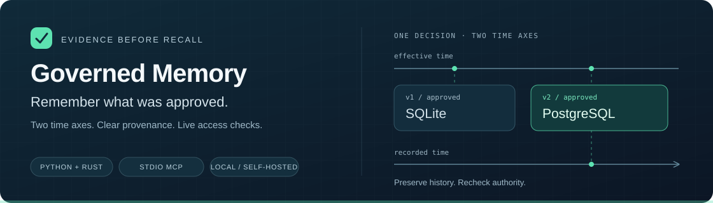

<p align="center"></p>

# Governed Memory

[](https://github.com/LE0-Lin/governed-memory/actions/workflows/ci.yml)
[](https://github.com/LE0-Lin/governed-memory/releases/latest)
[](pyproject.toml)
[](LICENSE)

**给编码 Agent 使用的持久证据记忆：先审批，再检索；同时保留有效时间与记录时间。**

[English](README.md) · [开始使用](docs/getting-started.md) · [评估与局限](docs/evaluation.md) · [发布包](https://github.com/LE0-Lin/governed-memory/releases/latest)

例如，Agent 提议“数据库改用 PostgreSQL”，操作者审核后才成为可信记忆。
后续补充一条迟到的更正，你可以分别查询“当时实际适用什么”和“当时我们知道什么”。
检索会实时复核权限、来源撤回和依赖，即使图投影或模型计算缓存尚未更新。

## 先运行一个完整示例

需要 **Python 3.12** 和 [uv](https://docs.astral.sh/uv/)，Windows/Linux 已有 CI 验证。
安装依赖后，核心示例无需 Docker、API Key、模型下载或外部服务。

```sh
git clone https://github.com/LE0-Lin/governed-memory.git
cd governed-memory
uv sync --frozen
uv run governed-memory demo
```

示例使用独立的内存 SQLite，不读取或修改你配置的实际账本；验证历史查询、迟到更正、
禁止 Agent 自行审批和来源撤回。输出包含：

```json
{"scenario":"unapproved injection","self_approval":"denied"}
{"scenario":"withdrawal","withdrawn_evidence_visible":false}
```

不想克隆仓库，可以安装[发布 wheel](https://github.com/LE0-Lin/governed-memory/releases/latest)
后执行同一个 `governed-memory demo`。安装命令、持久存储、MCP 配置和排错见
[使用指南](docs/getting-started.md)。核心示例的向量是词法哈希；语义模型和 Rust 内核
是单独启用的选项，不要求首次安装就下载全部模型。

## 接入实际编码会话

1. 初始化持久账本，保存操作者凭据。
2. 导入 ADR 或 JSONL，会先生成待审核提议。
3. 查看来源与版本，通过 CLI 审批。
4. 为 Agent 另发凭据，把它绑定到 MCP 进程。
5. 跨会话检索；修改、撤回或撤销权限后重新检查可见性。

默认工具为 `propose_memory`、`search_memory`、`explain_memory`。审批、撤回、发凭据
属于操作者命令，不暴露给 Agent 自行调用。可选本地回答模块提供 `answer_memory`。

| 能力 | 具体实现 |
| --- | --- |
| 双时间与来源 | 有效时间、系统记录时间、不可变快照、引用与审核轨迹 |
| 检索与预算 | BM25/向量融合、可选 Rust、固定本地 cross-encoder、整条证据 token 预算 |
| 治理 | 五状态、本地授权、可选 OpenFGA/OPA、受保护事实、来源撤回 |
| 图投影 | PostgreSQL 为权威，Graphiti/Neo4j 可重建；图返回 ID 后再查账本 |
| 语义摄入 | 分块、实体/NLI 审阅建议；模型建议不会自动获得审批 |
| 失效与血缘 | 绑定精确输入快照的依赖、多来源佐证、传递失效、OpenLineage 发件箱 |

[配置](docs/usage.md) · [部署/备份恢复](docs/deployment.md) · [设计](docs/design.md) · [代码阅读指南](docs/code-guide.md)

## 真实结果，也写清范围

最近一次完整链路性能测量是 **v0.8.1**。本轮展示/安装改动不构成新的性能成绩。

| 测量 | 已保存的结果 |
| --- | --- |
| 受控时间检索 | 每组 84 题中，60 道可回答题为 **60/60** |
| 大集合过期返回 | 三次相关重复中的 **0/792** 条返回 |
| 完整检索 P95 | 同机 CPU、模型已加载、单调用者，**0.762 秒** |
| 另一相关性保留集 | 可回答题 **47/48**，并非全部命中 |
| 可选 500 题回答任务 | 本地模型评分 **181/500**，不是官方或人工成绩 |

**60/60 不能写成通用准确率 100%，0/792 也不是永不失败的承诺。** 扩增的历史断言和
三次重复不等于独立新题；负例仍可能返回合法但不相关的证据。计时不含启动和生成。
完整定义、原始数据、失败和被拒绝的性能改动见[评估说明](docs/evaluation.md)。

## 使用状态与贡献

这是可用于本地 stdio MCP 和受控自托管的实验性开发工具。当前支持单个投影 worker、
增量升级和保留审计记录；没有分布式故障转移、公开 HTTP 服务或生产容量承诺。
存放实际数据前应阅读[备份与恢复](docs/deployment.md)。

```sh
uv sync --frozen --extra dev
uv run pytest -q
uv run python scripts/check_offline_demo.py
```

没有外部服务/模型配置时，一部分测试会明确跳过；CI 另行验证真实服务和模型。
发布检查会把 wheel 安装到新环境，在源码目录外验证持久 MCP 提议、审批、重启和撤回。
欢迎[报告问题](https://github.com/LE0-Lin/governed-memory/issues/new/choose)，参见
[贡献指南](CONTRIBUTING.md)、[安全说明](SECURITY.md)、[第三方归属](THIRD_PARTY.md)。

MIT 许可。
