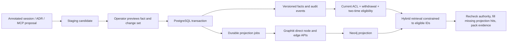
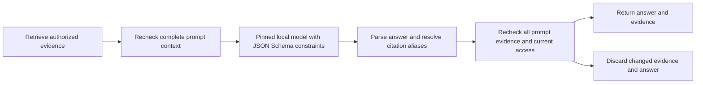

# Ledger, time and trust

## Data flow

`Source` records a locator, fragment, SHA-256 digest, receipt time and optional audience. Stable candidate IDs make repeated imports idempotent. A candidate has a stable logical fact ID derived from project, subject and predicate. Import does not extract arbitrary facts from prose: JSONL messages carry explicit `memory` annotations; Markdown ADRs use TOML metadata. These are structural formats, not semantic chunking.

## Two time axes

Every approved fact snapshot has UTC half-open intervals `[valid_from, valid_until)` and `[system_from, system_until)`. `valid_at` asks when the fact was effective; `known_at` asks what the service had recorded as approved by that time. Both default to one captured request time. Naive timestamps are rejected.

On an overlapping approval, the transaction closes the previous system-time snapshot, preserves any left/right valid-time slices, and inserts the newly approved snapshot. A correction received on November 12 but effective on November 10 therefore cannot change a query with `known_at=November 11`. Finite corrections restore the previous value outside the corrected interval. Original payloads and historical snapshots cannot be silently rewritten through normal SQL updates; database triggers also preserve the audit log and legal state transitions.

Search metadata follows the same knowledge boundary: a snapshot closure recorded after `known_at` is returned as unknown (`system_until: null`), rather than exposing the date of a later correction. `explain_memory` is a separate current-audit view; it is not an as-of query.

Candidate states are `proposed → active/rejected`, `active → superseded/revoked`, and `superseded → revoked`. Superseded candidates can support historical or retained interval slices. Retrieval uses the two interval predicates rather than current `state == active`. Re-enabling a rejected or revoked assertion requires a distinct candidate/version; reimporting the same source does not resurrect it.

Current source withdrawal, credential/project access and source audiences override historical visibility. An old `known_at` cannot restore access. This intentionally means that an audit view reconstructed today can omit evidence that has since been withdrawn; it is not an immutable snapshot of a past user's authorization.

## Approval boundary

The MCP process's credential is bound by server environment. Tool arguments cannot claim a different identity, role, approval or protection status. The CLI checks the same credential store; knowing a candidate UUID does not grant access. Tokens are random and only SHA-256 token hashes are stored.

An approver sees structured values and overlapping versions with their sources. Approval requires both the candidate revision and logical fact-head revision returned by `preview`. PostgreSQL advisory locks serialize competing decisions for the same fact, and stale heads fail. Protected fact changes and protected-source withdrawal require an administrator. This is a service policy, not protection against the database owner.

The built-in policy is always enforced. When `MEMORY_OPA_URL` is configured, the service also asks the bundled Rego policy to allow the decision. The server constructs policy input from authenticated roles and stored state. An unavailable OPA service or a response other than boolean `true` prevents the transaction from committing; there is no permissive fallback. OPA can restrict the built-in rules, but cannot relax them.

Candidates never call Graphiti `add_episode` or `add_triplet`: extraction, resolution and contradiction handling could otherwise alter trusted relationships before review. Only committed approved snapshots are projected, using stable snapshot UUIDs and explicit node/edge saves. Graphiti does not decide approval or authoritative temporal history. Nodes have no synthesized cross-source summaries, and retrieval returns ledger text rather than graph text.

## Corroborating sources

`approve-support` links a staged candidate to an already approved assertion. Subject, predicate, value and the entire original valid interval must match exactly. The operator supplies both candidate revisions and the shared fact-head revision. Approval appends an immutable support link and audit events without creating a second timeline. It does not infer that two documents are independent or that a claim is true. Support chains are rejected.

Every returned source must independently satisfy current withdrawal and audience restrictions. Its receipt and support approval must also be no later than `known_at`. Sources are loaded in batches. A withdrawn or inaccessible primary source is replaced in response provenance by an eligible supporting source; the excluded source's locator, hash and fragment are not returned. Later support cannot make an assertion visible in an earlier knowledge view.

Withdrawing one source suppresses only that source. The assertion remains visible while another approved source passes the caller's checks. Revoking the root assertion suppresses the assertion and all its support; revoking a supporting candidate removes only that support. These actions queue affected historical snapshots for reprojection. When the last usable source disappears, projection processing removes the edge. Authoritative reads enforce withdrawal before the worker catches up.

## Projection and retrieval

Approval and outbox jobs commit in one SQL transaction. Jobs keep attempts, generation and completion state. Failed graph operations retain pending work. Old worker completion cannot acknowledge a newer generation. Replays upsert the same edge UUID; `--rebuild` can repopulate a fresh graph. One controlled worker per graph is supported; concurrent graph writers are outside this version's contract.

Before query embeddings or graph search, the ledger filters project, source audience, withdrawal, approval and both time intervals. Graphiti receives only eligible edge UUIDs and a project group. Hybrid RRF is used. An optional local cross-encoder reranks at most 50 candidates, after another authority check. Returned UUIDs are joined back to the authorized ledger set, rechecked before serialization, and missing/stale projection candidates can be supplemented from the ledger. A graph outage is reported as a fallback backend, rather than reported as successful graph search.

Default offline retrieval uses real BM25 (`rank-bm25`) plus cosine similarity of 1,024-dimensional lexical hash vectors and RRF. Because those vectors have no semantic meaning, queries with no lexical overlap can abstain. The optional MiniLM embedder produces normalized 384-dimensional vectors, padded with zeros to the existing graph width; this preserves cosine similarity. The optional cross-encoder returns actual learned relevance logits. Neither learned channel has a calibrated abstention threshold. External embeddings can be injected separately. These options do not establish general relevance or prompt-injection defense.

Each graph edge records an embedding-profile fingerprint. Before vector search, an explicit query restricts eligible UUIDs to the configured profile. An older or differently embedded edge is filled from the ledger instead of compared in the wrong vector space. Rebuild the projection after switching models. Model revisions and inference limits are in `local_models.py`; downloads are optional and remote model code is disabled.

The budget covers the complete serialized `evidence` array, including IDs, text and source metadata, using the vendored `cl100k_base` vocabulary. Facts are included whole or omitted; text and provenance are not truncated apart. Response envelope, MCP framing, the query and any downstream answer are outside that evidence budget. Special-token spellings in source text are counted as ordinary untrusted text.

## Answer generation

The optional answer path shares retrieval eligibility and evidence budgeting.
The complete chat prompt also has a separate model-token limit; an overlong
prompt fails closed. Only question/date and evidence text/dates enter generation.
Short aliases map back to returned snapshot IDs. The schema constrains structure
and possible aliases, and the parser requires citations for an answer and none
for abstention. These checks do not establish citation entailment or truth.

Before returning text, the service compares the complete supplied context with
current ledger visibility, including uncited evidence. A source or metadata
change discards the answer and evidence; revoked project access denies the
request. Missing evidence, generation exceptions and malformed output produce a
fixed abstention with a reason. Application responses omit raw model text; the
public-data benchmark explicitly retains it. Generated answers never
write candidates, facts or approval events.

## Operational limits

- PostgreSQL is the persistent/concurrent backend. SQLite is for single-writer demos and deterministic checks.
- Project filtering currently loads eligible evidence before ranking; this is not a large-scale retrieval architecture.
- Stdio is a local transport. An agent with access to the server's host, SQL credentials or operator token is outside the credential-bound tool threat model. Operator credentials must not be put in agent configuration.
- Withdrawal is logical suppression. Audit rows and stale graph copies may remain until the controlled worker runs; physical/backup erasure is not implemented.
- External embedding models can receive approved text through an explicitly configured provider. No paid-provider quality or latency result is supplied. Local model inference stays on the host after downloading weights.
- `upgrade` adds the v0.2 support table and triggers while preserving v0.1 rows. Recovery uses PostgreSQL's dump/restore tools and graph reconstruction; [the local container path](deployment.md) is tested. General schema migration, rollback and distributed failover are outside this version's scope.
