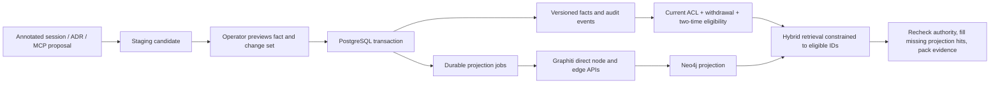

# Ledger, time and trust

## Data flow

`Source` records a locator, fragment, SHA-256 digest, receipt time and optional audience. Stable candidate IDs make repeated imports idempotent. A candidate has a stable logical fact ID derived from project, subject and predicate. Import does not extract arbitrary facts from prose: JSONL messages carry explicit `memory` annotations; Markdown ADRs use TOML metadata. These are structural formats, not semantic chunking.

## Two time axes

Every approved fact snapshot has UTC half-open intervals `[valid_from, valid_until)` and `[system_from, system_until)`. `valid_at` asks when the fact was effective; `known_at` asks what the service had recorded as approved by that time. Both default to one captured request time. Naive timestamps are rejected.

On an overlapping approval, the transaction closes the previous system-time snapshot, preserves any left/right valid-time slices, and inserts the newly approved snapshot. A correction received on November 12 but effective on November 10 therefore cannot change a query with `known_at=November 11`. Finite corrections restore the previous value outside the corrected interval. Original payloads and historical snapshots cannot be silently rewritten through normal SQL updates; database triggers also preserve the audit log and legal state transitions.

Search metadata follows the same knowledge boundary: a snapshot closure recorded after `known_at` is returned as unknown (`system_until: null`), rather than exposing the date of a later correction. `explain_memory` is a separate current-audit view; it is not an as-of query.

Candidate states are `proposed → active/rejected`, `active → superseded/revoked`, and `superseded → revoked`. Superseded candidates can support historical or retained interval slices. Retrieval uses the two interval predicates rather than current `state == active`. Re-enabling a rejected or revoked assertion requires a distinct candidate/version; reimporting the same source does not resurrect it.

Current source withdrawal, credential/project access and source audiences override historical visibility. An old `known_at` cannot restore access. This intentionally means that an audit view reconstructed today can omit evidence that has since been withdrawn; it is not an immutable snapshot of a past user's authorization.

## Approval boundary

The MCP process's credential is bound by server environment. Tool arguments cannot claim a different identity, role, approval or protection status. The CLI checks the same credential store; knowing a candidate UUID does not grant access. Tokens are random and only SHA-256 token hashes are stored.

An approver sees structured values and overlapping versions with their sources. Approval requires both the candidate revision and logical fact-head revision returned by `preview`. PostgreSQL advisory locks serialize competing decisions for the same fact, and stale heads fail. Protected fact changes and protected-source withdrawal require an administrator. This is a service policy, not protection against the database owner.

Candidates never call Graphiti `add_episode` or `add_triplet`: extraction, resolution and contradiction handling could otherwise alter trusted relationships before review. Only committed approved snapshots are projected, using stable snapshot UUIDs and explicit node/edge saves. Graphiti does not decide approval or authoritative temporal history. Nodes have no synthesized cross-source summaries, and retrieval returns ledger text rather than graph text.

## Projection and retrieval

Approval and outbox jobs commit in one SQL transaction. Jobs keep attempts, generation and completion state. Failed graph operations retain pending work. Old worker completion cannot acknowledge a newer generation. Replays upsert the same edge UUID; `--rebuild` can repopulate a fresh graph. One controlled worker per graph is supported; concurrent graph writers are outside this version's contract.

Before query embeddings or graph search, the ledger filters project, source audience, withdrawal, approval and both time intervals. Graphiti receives only eligible edge UUIDs and a project group. Hybrid RRF is used; no cross-encoder or extraction LLM is invoked. Returned UUIDs are joined back to the authorized ledger set, rechecked before serialization, and missing/stale projection candidates can be supplemented from the ledger. A graph outage is reported as a fallback backend, rather than reported as successful graph search.

Offline retrieval uses real BM25 (`rank-bm25`) plus cosine similarity of 1,024-dimensional lexical hash vectors and RRF. Because those vectors have no semantic meaning, queries with no lexical overlap can abstain. Optional external embeddings can be injected separately. This is not a general natural-language relevance or prompt-injection defense.

The budget covers the complete serialized `evidence` array, including IDs, text and source metadata, using the vendored `cl100k_base` vocabulary. Facts are included whole or omitted; text and provenance are not truncated apart. Response envelope, MCP framing, the query and any downstream answer are outside that evidence budget. Special-token spellings in source text are counted as ordinary untrusted text.

## Operational limits

- PostgreSQL is the persistent/concurrent backend. SQLite is for single-writer demos and deterministic checks.
- Project filtering currently loads eligible evidence before ranking; this is not a large-scale retrieval architecture.
- Stdio is a local transport. An agent with access to the server's host, SQL credentials or operator token is outside the credential-bound tool threat model. Operator credentials must not be put in agent configuration.
- Withdrawal is logical suppression. Audit rows and stale graph copies may remain; physical/backup erasure and cross-source support propagation are not implemented.
- External embedding models can receive approved text through an explicitly configured provider. No external-model quality or latency result is included in the offline evaluation.
- This first schema supports fresh initialization; migration and disaster-recovery tooling are not supplied.
